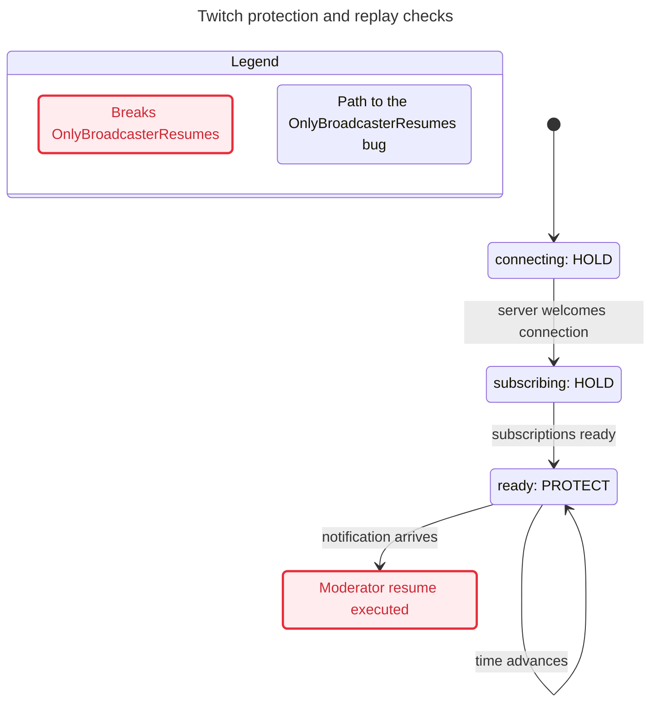
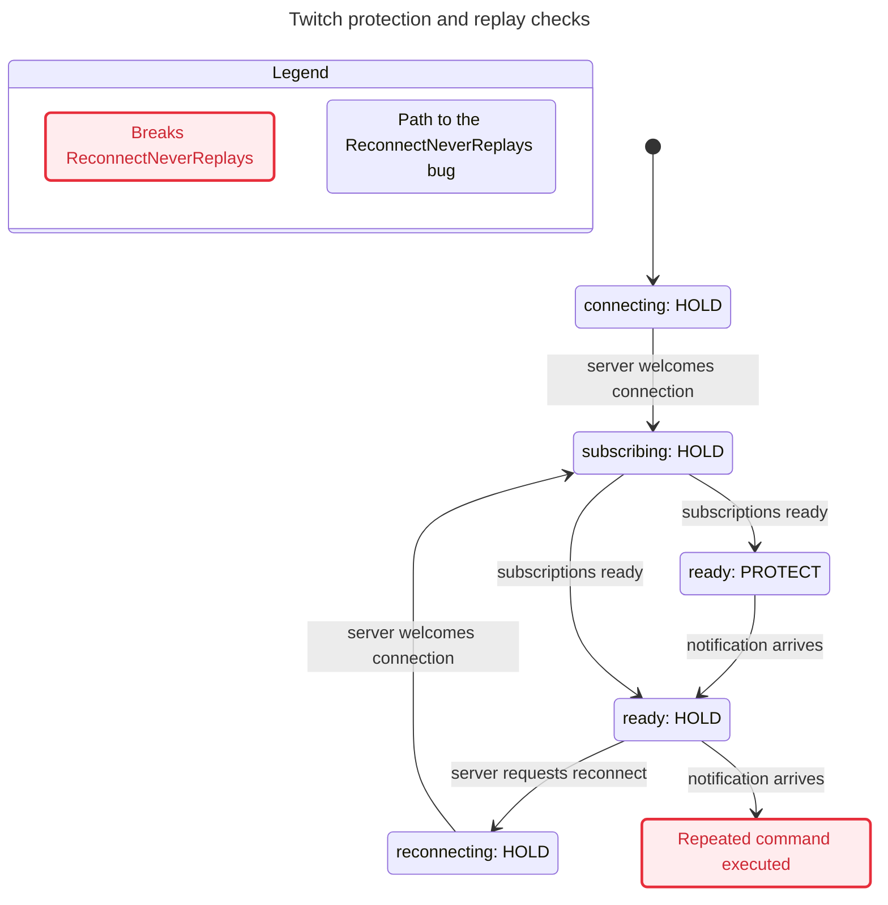
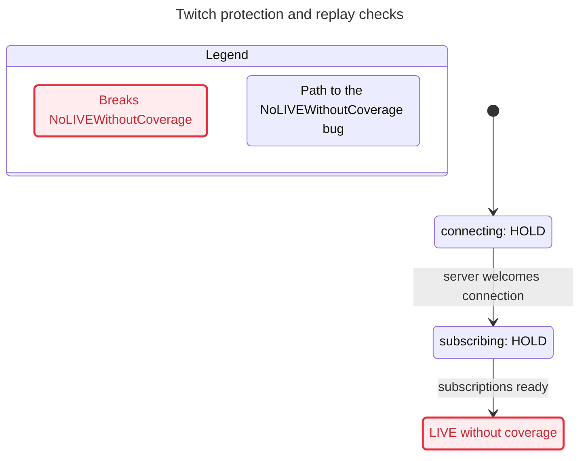

# M3 control and EventSub model verification

The restored finite model passed all four requested invariants twice. Each deliberate
mutation failed its intended invariant. Replaying every shortest mutation trace against
the unchanged parent Python implementation produced the correct rejection. No real
implementation defect was demonstrated by these traces. This is a bounded safety check,
not a proof of the complete transport, video pipeline, or every possible envelope.

Implementation child: `m3-model`. Prepared checkout:
`/home/elan/.t3/worktrees/irl-shield/t3-c162e57f`, branch `t3/c162e57f`, HEAD
`ec1d1f96a1c29ab82109c66f27064f3fd6cb326d`. The first operation ran `pwd`,
`git branch --show-current`, `git rev-parse HEAD`, and `git status --short`;
the checkout was clean and at that HEAD. The parent's current `docs/model/` was copied
before editing. Only this child's `docs/model/` and owned OS scratch were written.
No commits, staging, pushes, PRs, new agents, installs, Mac jobs, secrets reads,
network connections, Twitch calls, or parent-file edits were performed.

## Evidence and invocation budget

All model executions used the statechart helper from OS scratch:
`/tmp/agents/irl-shield/m3-model/`. [commands.sh](evidence/commands.sh) records the
exact historical shell commands. [java-invocations.log](evidence/java-invocations.log)
records every Java argument vector, including the helper's continuation runs.
Six helper calls launched **9 TLC invocations** and 6 SANY parsing invocations.
Two Python harness invocations bring this child's test/TLC budget use to **11**.
The packet reports one earlier incomplete parent TLC invocation; including that gives
**12 combined**. SANY parsing is enumerated separately, not counted as a test or TLC run.
The `pass-1` label here is this child's own precedence-error attempt; the parent's incomplete `pass-1` was never copied or used as evidence.
No gate/pytest invocation was made in this docs-only child. The conductor owns the
full gate and production Python mutation tests.

| Helper call | Helper exit | First TLC generated / distinct / queued | Result and shortest failing path |
| --- | ---: | --- | --- |
| `pass-1` | 2 | Error before a completed exploration | TLA+ precedence error; no pass claimed |
| `pass-2` | 0 | 69,693 / 5,312 / 0 | All requested invariants hold; graph depth 15 |
| `authority` | 1 | 1,170 / 165 / 80 | `OnlyBroadcasterResumes` fails; 5 transitions |
| `replay` | 1 | 8,102 / 1,006 / 548 | `ReconnectNeverReplays` fails; 7 transitions |
| `coverage` | 1 | 37 / 20 / 15 | `NoLIVEWithoutCoverage` fails; 2 transitions |
| `restored` | 0 | 69,693 / 5,312 / 0 | All requested invariants hold again; graph depth 15 |

Receipts: [baseline raw TLC](evidence/pass-2/tlc.out),
[authority raw TLC](evidence/authority/tlc.out),
[replay raw TLC](evidence/replay/tlc.out),
[coverage raw TLC](evidence/coverage/tlc.out),
[restored raw TLC](evidence/restored/tlc.out),
[first model error](evidence/pass-1.command.log).
Each run directory also contains the helper's report; the three failing runs contain
its exact `chart.mmd`. State counts in this table are the first TLC run on the config
as written, directly from `tlc.out`. Generated states include duplicates; distinct
states use TLC's fingerprints, retaining all model variables with no VIEW or SYMMETRY.
Zero queued states in the passing runs means exploration completed in the finite model.
The restored raw output reports TLC's optimistic fingerprint collision estimate of
`1.9E-11`; this is TLC's estimate, not a measured probability of code correctness.

After finding each deliberate violation, the helper removes that invariant and runs
TLC again to check the remaining invariants. Its reports give 6,488 distinct states for
authority, 29,412 for replay, and 5,312 for coverage; each is below the helper's 100,000
continuation bound, and no rules are listed as unchecked. The helper retains the first
run's raw `tlc.out`, not the raw output from these successful continuation runs. Their
receipts are the generated reports and Java invocation log. No additional chart-drawing
TLC invocation occurred: all completed graphs exceeded the helper's 500-state chart budget.

The first model attempt omitted parentheses around disjunctions assigned to primed
variables in `Fault` and the replay ghost update. TLC reported `identifier revoked is
either undefined or not an operator`; the incorrect source is preserved in
[TwitchControl.precedence-error.tla.txt](evidence/TwitchControl.precedence-error.tla.txt).
Those assignments were parenthesized before the successful baseline. No invariant
was changed or weakened to obtain a pass.

All invocations were sequential. The commands used `systemd-run --user --scope
--slice=app-t3code-agents.slice -p CPUQuota=200% nice -n 10`, with the required XDG/DBus
settings. Java used `-XX:ActiveProcessorCount=2 -Xmx1g -XX:+UseParallelGC`.
The helper pins `-workers 1 -fp 0 -lncheck final`, visible in the Java log and raw TLC
headers. One worker is within the two-worker ceiling. Process cleanup is recorded below.

## What the model checks

[TwitchControl.tla](TwitchControl.tla) and [TwitchControl.cfg](TwitchControl.cfg) contain
these unchanged requested rules:

| Invariant | Reader's rule | Model evidence |
| --- | --- | --- |
| `NoLIVEWithoutCoverage` | LIVE requires coverage and no chat, Shield Mode, local, or connection hold. | `mode = "LIVE" => coverage /\ ~chat /\ ~shield /\ ~local /\ ~connection` |
| `OnlyBroadcasterResumes` | Only the broadcaster can execute a chat resume. | `resumedBy` records every executed chat resume, including an attempted release when no chat hold exists. |
| `ReconnectNeverReplays` | A command envelope must never execute a second time, including across reconnect, eviction, and expiry. | Ghost `executed` and latched `replayed` observe command callbacks, not just state changes. |
| `BoundedMemory` | Replay-cache entries never exceed configured capacity. | `Len(seen) <= Capacity` |

`NoDeadlock` also holds. `Idle` deliberately represents inactive deliveries, early malformed
input, revoked welcomes, invalid `ready()` calls, and an open session receiving nothing.
It permits stuttering in every state, so the deadlock result is **not** a liveness signal
or a claim that subscriptions eventually become ready.

Finite constants are `Capacity = 1`, `MaxAge = 2`, `LastClock = 5`. Six immutable envelopes
have timestamps in `1..3`: moderator hold at 1, owner resume at 2, moderator resume at 3,
Shield Mode begin at 2, Shield Mode end at 3, and viewer hold at 3. Clock ticks run from
1 through 5; age-floor advancement occurs only in `Deliver`, just as it occurs only in
`accept()` in Python. Timestamp 0 abstracts `started_at - epsilon`; timestamp 1 maps to
Python `started_at`, and each further model tick is one second. All valid messages are
at or after session start; future messages are rejected until the clock reaches them.

Each delivery independently varies a parseable-envelope validity flag and whether chat
originates locally. Parseable but invalid envelopes still purge expired IDs before
rejection. Foreign shared-chat commands are remembered before being ignored. Both chat
and Shield Mode notifications use the same admission, FIFO eviction, floor advancement,
and ID cache. Chat hold uses `max(chatTime, at)`; chat resume requires strictly newer
time. Shield Mode end cannot undo a later or equal-time begin. The existing copied model
had sent Shield Mode changes around the replay cache; that shortcut was removed.

## Mapping to the current parent implementation

Source checkout: `/home/elan/.t3/worktrees/irl-shield/t3-3bb00dac`. These are the parent's
uncommitted M3 files at the hashes below, not a claim that base HEAD already contains
them. All four hashes matched before modeling and immediately after the Python replay;
see [initial hashes](evidence/source-hashes.initial.json) and
[post-replay hashes](evidence/source-hashes.final.json). A subsequent hand-back inspection
caught the parent changing `transport.py`; [hand-back hashes](evidence/source-hashes.handback.json)
record the drift. Its later hash is
`1fecd5b6203bade287fea65337e59640ec964102b0877c064442f6b6885a96e7`.
Control, ShieldEvents, and the event tests were unchanged. The transport mapping below
was refreshed from that later source; no transport execution or test result is claimed.

- `shield/control.py`: `806c51102caea5ba06985831412c89452fd0a000fd5b0343f1535cc5674b244d`
- `shield/twitch/events.py`: `12331861c469d9f9e3cb5c8a1acb2cfa2b7a6f7ddfddf302a5e1983f1d696c29`
- `shield/twitch/transport.py`: `a5526f02c9369ab1273cacab1b00d10b4217b56885f4164eb7961bf67aeb3081`
- `tests/m3/test_events.py`: `1ea7550f101ddc7e15e53c4f8bf631b4ff691ee64497b9b036f3951c5f9e8a4b`

| Model state/action | Concrete implementation and mapping |
| --- | --- |
| `Init` | `Control.__init__` starts PROTECT; constructing `ShieldEvents` synchronously asserts the connection hold. The model begins after both calls. [control.py:11](/home/elan/.t3/worktrees/irl-shield/t3-3bb00dac/shield/control.py:11), [events.py:33](/home/elan/.t3/worktrees/irl-shield/t3-3bb00dac/shield/twitch/events.py:33). |
| `mode`, `Settle` | `Control.state` and `_settle`: any hold has priority, then coverage chooses LIVE/PROTECT. [control.py:42](/home/elan/.t3/worktrees/irl-shield/t3-3bb00dac/shield/control.py:42). Reasons and ledger entries are abstracted out. |
| `coverage`, `Coverage(c)` | `Control.update_coverage(c, reason, at)` updates coverage and settles. [control.py:37](/home/elan/.t3/worktrees/irl-shield/t3-3bb00dac/shield/control.py:37). |
| `local`, `LocalHold(h)` | `Control.set_hold(h, source='local', ...)` changes only that named hold. [control.py:31](/home/elan/.t3/worktrees/irl-shield/t3-3bb00dac/shield/control.py:31). |
| `chat`, `shield`, `connection` | Presence of `chat`, `shield-mode`, `twitch-connection` in Control's hold dictionary. Each callback alters only its source. No transport action releases chat, shield, or local. [events.py:52](/home/elan/.t3/worktrees/irl-shield/t3-3bb00dac/shield/twitch/events.py:52), [events.py:123](/home/elan/.t3/worktrees/irl-shield/t3-3bb00dac/shield/twitch/events.py:123). |
| `phase`, `revoked`, `Welcome`, `Ready` | `ShieldEvents.phase`, `_revoked`, `welcome(valid_session_id)`, `ready()`. Valid welcomes are permitted in any nonrevoked phase; a welcome does not itself release the connection hold. [events.py:55](/home/elan/.t3/worktrees/irl-shield/t3-3bb00dac/shield/twitch/events.py:55). |
| `Reconnect` | `reconnect(approved_url)` enters reconnecting and asserts a connection hold. With restored flags it preserves cache, floor, timestamps, and revocation latch. It can run even after revocation; revocation still prevents `ready()`. [events.py:68](/home/elan/.t3/worktrees/irl-shield/t3-3bb00dac/shield/twitch/events.py:68). |
| `Fault(r)` | `fault(..., revoked=r)`, also used by invalid welcomes and rejected reconnect URLs. The latch is monotonic; subsequent faults cannot undo it. [events.py:78](/home/elan/.t3/worktrees/irl-shield/t3-3bb00dac/shield/twitch/events.py:78). |
| `now`, `Tick` | Injected `clock` callable advanced by the environment; it alone does not prune IDs. [events.py:94](/home/elan/.t3/worktrees/irl-shield/t3-3bb00dac/shield/twitch/events.py:94). |
| `seen`, `floor`, first half of `Deliver` | `_seen` as insertion-ordered ID sequence, `_floor` as scalar. Purge, metadata validity, duplicate rejection, oldest-insertion eviction, and conservative floor rejection occur in Python order. [events.py:95](/home/elan/.t3/worktrees/irl-shield/t3-3bb00dac/shield/twitch/events.py:95). |
| `chatTime`, `shieldTime`, latter half of `Deliver` | `_chat_time`, `_shield_time`, identity/badge authority, shared-chat guard, and command callbacks. [events.py:116](/home/elan/.t3/worktrees/irl-shield/t3-3bb00dac/shield/twitch/events.py:116). |
| `executed`, `replayed`, `resumedBy` | Verification-only history of actual command callbacks. They have no production storage counterpart. The scratch Python harness observes these through the constructor's public `hold` callback. |

The public Python interface matches the existing adapter in
[tests/m3/test_events.py:23](/home/elan/.t3/worktrees/irl-shield/t3-3bb00dac/tests/m3/test_events.py:23):
`ShieldEvents` calls `hold(..., now=...)`; the adapter passes that time positionally into
`Control.set_hold(..., at)`. No engine/control fork or signature change is needed.

The transport owns network I/O and calls this same policy instance: `_connect` faults
before connecting ([transport.py:45](/home/elan/.t3/worktrees/irl-shield/t3-3bb00dac/shield/twitch/transport.py:45));
welcome/ready map subscription setup ([transport.py:55](/home/elan/.t3/worktrees/irl-shield/t3-3bb00dac/shield/twitch/transport.py:55));
reconnect validates policy before transport migration ([transport.py:65](/home/elan/.t3/worktrees/irl-shield/t3-3bb00dac/shield/twitch/transport.py:65));
known subscription notifications call `accept()` ([transport.py:80](/home/elan/.t3/worktrees/irl-shield/t3-3bb00dac/shield/twitch/transport.py:80));
revocation and disconnect call `fault()` ([transport.py:87](/home/elan/.t3/worktrees/irl-shield/t3-3bb00dac/shield/twitch/transport.py:87)).
The later idle-validation failure also maps to `Fault(TRUE)`
([transport.py:164](/home/elan/.t3/worktrees/irl-shield/t3-3bb00dac/shield/twitch/transport.py:164));
the redirect refusal added inside `_connect` and task cleanup remain outside this model.
This mapping does not execute or verify the private upstream hooks, subscriptions,
async/thread ordering, or transport cleanup. The harness imports only Control and
ShieldEvents, never transport/auth and never makes a network request.

## Deliberate violations and concrete replays

[replay_counterexamples.py](replay_counterexamples.py) was copied to OS scratch and
executed there against the actual parent imports with bytecode writes disabled.
It reads the preserved TLC traces, executes one public action for each transition,
checks observable phase/mode/cache size, and records every hold callback. It neither
copies nor mutates the parent's Python implementation. The final invocation exited 0:
[python-replay.log](evidence/python-replay.log), **3/3 scenarios passed**.

The first harness invocation exited 1 after authority passed: it incorrectly expected
the restored implementation's cache to match the replay mutant's emptied cache at step 4.
The corrected harness explicitly requires Python to retain that cached ID at reconnect,
then requires the repeated notification to be rejected at step 7. Both its
[first source](evidence/replay_counterexamples.first.py.txt) and
[first log](evidence/python-replay.first.log) are retained; this was a harness assertion
error, not an implementation failure.

| Mutation config | Named invariant and numbered shortest path | Replay against restored parent |
| --- | --- | --- |
| [authority.cfg](evidence/authority.cfg): `AllowModeratorResume = TRUE` | `OnlyBroadcasterResumes`: only broadcaster executes a chat resume. 0 Init; 1 Welcome; 2 Ready; 3 Tick to 2; 4 Tick to 3; 5 Deliver moderator resume. | Returns `ignored`, with zero chat-release callbacks: **correct rejection**. |
| [replay.cfg](evidence/replay.cfg): `ForgetOnReconnect = TRUE` | `ReconnectNeverReplays`: no second execution of a command envelope. 0 Init; 1 Welcome; 2 Ready; 3 Deliver hold; 4 Reconnect; 5 Welcome; 6 Ready; 7 Deliver same hold. | Cache remains at one entry across reconnect; second hold returns `duplicate` with no second command callback: **correct rejection**. |
| [coverage.cfg](evidence/coverage.cfg): `BadCoverage = TRUE` | `NoLIVEWithoutCoverage`: LIVE needs coverage and every hold absent. 0 Init; 1 Welcome; 2 Ready. | Control remains `PROTECT`: **correct rejection**. |

These are model mutations, not evidence of failing production Python mutations. The
parent owns those tests. Minimal corresponding production mutation sites for the parent:

- Authority: `shield/twitch/events.py:127`, broaden owner-only resume to include moderator.
  The existing `ChatControl.test_only_broadcaster_resumes_and_cannot_release_other_holds`
  at `tests/m3/test_events.py:35` exercises that authority rule with an active chat hold.
- Replay: `shield/twitch/events.py:74`, clear `_seen` and reset `_floor` on reconnect.
  The existing `test_replay_floor_survives_reconnect_capacity_and_expiry` at
  `tests/m3/test_events.py:50` expects an old evicted hold to stay invalid after reconnect.
  The exact shortest model replay instead repeats a still-cached hold and expects `duplicate`.
- Coverage: `shield/control.py:46`, choose LIVE when there are no holds even when coverage
  is false. Exercise the public `Control` + `ShieldEvents` welcome/ready sequence with
  coverage left missing, as in the two-step replay above.

No parent tests or Python mutations were written or run here.

## Helper Mermaid output

The passing graphs exceed 500 states, so the helper emitted no passing `chart.mmd`.
The following exact Mermaid text is generated for the three deliberate violations.
The helper shows only bug paths; ordinary off-path transitions and states are omitted,
not asserted impossible. Coarse labels merge protected states with different hidden
clocks/caches, so the authority chart has a time self-loop while its numbered trace has
two separate ticks. Idle does not occur on these shortest paths; the helper's path-only charts omit other unrelated actions. Each failing state's mark names exactly its violated invariant.

### authority



### replay



### coverage



## Abstraction limits

- Bounds are one cached ID, six fixed envelopes, five integer clock values, four named
  hold sources, one policy instance, and sequential atomic public calls. The check does
  not establish all capacities, the default 4,096-entry/600-second setting, arbitrary
  timestamp precision, or concurrent interleavings within Python calls. Capacity one
  exercises eviction and expiry, but does not test ordering among multiple retained IDs.
- IDs identify immutable full envelopes, matching re-delivery of an unchanged notification.
  This does not prove safety when an upstream sends the same ID with altered content or
  a later timestamp after eviction. Clock progression is monotonic in the model.
- Metadata validity, local/foreign channel matching, and already-normalized command text
  are abstract inputs. Malformed structures before timestamp extraction are no-ops;
  parseable invalid metadata may purge the cache. The exact parser, URL allowlist,
  badge structures, whitespace normalization, and authenticated provenance remain Python
  and transport test responsibilities. The six representative messages do not enumerate
  every actor/topic/timestamp combination; in particular, the fixed Shield begin/end
  timestamps do not test their equal-time conflict branch.
- Only **chat resume** requires broadcaster identity. A valid Twitch Shield Mode end
  releases only `shield-mode` under that topic's timestamp rule. The model does not
  falsely require its moderator actor to be the broadcaster or allow it to release chat.
- `BoundedMemory` is specifically the replay-cache bound. It is not a total process-memory
  bound. `Control._transitions` appends on every state change (`control.py:48`), and this
  model does not bound that ledger. Control also accepts arbitrary hold-source strings;
  only four fixed sources are modeled. If M3 requires a bound on the whole Control ledger
  or all possible source keys, that requirement remains open for the parent.
- Reasons, reason precedence, session-ID values, callback errors, effect delivery,
  scheduling, asyncio/thread behavior, OAuth, refresh, revocation delivery reliability,
  upstream subscription tracking, video coverage computation, and stream ingest are
  outside this safety projection. No bench/media job ran because no production pipeline
  code changed and media jobs are explicitly outside this packet.
- All safety rules are retained across the finite graph; no fairness, eventual reconnect,
  eventual readiness, or real-world delivery guarantee is claimed. Model mutation
  failures plus correct Python rejection do not replace production mutation tests.

## Tools, hashes, and licenses

Pinned existing installations were reused read-only; nothing was downloaded or installed.
TLC's own raw header identifies version 2.19 of 2024-08-08, revision `5a47802`; the JAR
manifest identifies tag `v1.7.4`, revision `5a47802b5c391f59ecdd44117981f4ff8c0656ba`.
This difference is an internal TLC header versus distribution tag, not a substituted tool.

| Artifact | SHA-256 | License/source receipt |
| --- | --- | --- |
| `/home/elan/.local/share/mise/installs/http-tla2tools/1.7.4/tla2tools.jar` | `936a262061c914694dfd669a543be24573c45d5aa0ff20a8b96b23d01e050e88` | MIT, extracted from its `META-INF/LICENSE.txt` to [TLC-LICENSE.txt](evidence/TLC-LICENSE.txt). |
| `/home/elan/.local/share/mise/installs/java/temurin-25/bin/java` | `1bf1aaef01e4f8d7c85d913c60fb2ee4624cbe54d4053254c59657b7ea913b25` | Installed `legal/java.base/LICENSE`, GPL v2 with Classpath Exception (exception begins at line 326). Java is not redistributed here. |
| `/home/elan/.agents/skills/statechart/scripts/statechart` | `aeffb7077850fd4c225e3d18049ca6ed7b988cf48e88cd8463526a7feaa74d13` | Existing local helper, reused read-only. No license grant or redistribution assumed. |
| `/home/elan/.agents/skills/statechart/scripts/run.ts` | `f330e0a3b0a9f8181c2e52252c4a47db3f0a64f79a7cca5490263e33a5f13c72` | Existing local helper implementation; pins one TLC worker and continuation behavior. |

The Java argv wrapper only records nonsensitive tool arguments and executes the pinned
Java binary. Its [source](evidence/java-wrapper.sh) is original work in this child.
The model, view, and replay harness are original project code; no third-party model,
dataset, or media asset was introduced. [SHA256SUMS](SHA256SUMS) covers every delivered
file except itself and this report to avoid a circular hash; this report's hash is given
in the final hand-back.

## Reproduction

Run from a new OS scratch directory. This uses the pinned Java directly; the historical
run's wrapper is only necessary to reproduce the invocation ledger. Every `--out` must
be new or empty. The commands below are instructions, not additional invocations used
in this child's test budget.

```sh
work=/tmp/agents/irl-shield/m3-model-recheck
mkdir -p "$work"
cp docs/model/TwitchControl.tla docs/model/TwitchControl.cfg docs/model/view.mjs "$work/"
XDG_RUNTIME_DIR=/run/user/1000 DBUS_SESSION_BUS_ADDRESS=unix:path=/run/user/1000/bus \
  systemd-run --user --scope --slice=app-t3code-agents.slice -p CPUQuota=200% nice -n 10 \
  env JAVA=/home/elan/.local/share/mise/installs/java/temurin-25/bin/java \
  TLA2TOOLS=/home/elan/.local/share/mise/installs/http-tla2tools/1.7.4/tla2tools.jar \
  JAVA_TOOL_OPTIONS='-XX:ActiveProcessorCount=2 -Xmx1g -XX:+UseParallelGC' \
  /home/elan/.agents/skills/statechart/scripts/statechart "$work/TwitchControl.tla" \
  --config "$work/TwitchControl.cfg" --view "$work/view.mjs" --out "$work/restored-new"
```

For each deliberate violation, copy its preserved `evidence/{authority,replay,coverage}.cfg`
into scratch and supply it as `--config`, with a fresh `--out`. Each mutation changes only
its one named flag; all flags in the delivered default config are FALSE.

To replay the preserved shortest paths through the parent's public interfaces:

```sh
cp docs/model/replay_counterexamples.py "$work/"
cp -a docs/model/evidence "$work/evidence"
XDG_RUNTIME_DIR=/run/user/1000 DBUS_SESSION_BUS_ADDRESS=unix:path=/run/user/1000/bus \
  systemd-run --user --scope --slice=app-t3code-agents.slice -p CPUQuota=200% nice -n 10 \
  env PYTHONDONTWRITEBYTECODE=1 python3 "$work/replay_counterexamples.py" \
  --source /home/elan/.t3/worktrees/irl-shield/t3-3bb00dac --evidence "$work/evidence"
```

Use the source-hash receipts before treating a replay against a later parent revision as
reproduction of this hand-back. Skills read: codebase-design, tdd, test-review's gate,
research, full statechart, and diagnosing-bugs' source/hypothesis guidance. No independent
review or merge authority is claimed by this implementation child.

## Cleanup and hand-back

At `2026-10-30T04:12:20.803830+00:00`, all eight owned systemd scopes reported
`LoadState=not-found`, `ActiveState=inactive`, `SubState=dead`; each inspection exited 0.
The process snapshot found no live Java/Node/Python/shell worker using this scratch path.
See [process-cleanup.json](evidence/process-cleanup.json). All six helper sessions and
both Python harness commands have exited (helper exits: 2, 0, 1, 1, 1, 0; Python: 1, 0).
No owned process required termination after completion, and no survivor is handed off.

All changed/new paths are under this child's `docs/model/`. They are uncommitted and
unstaged for the conductor to review and copy. `git status --short` reports only `?? docs/model/`.
`git ls-files --error-unmatch` for the model, config, view, and report exits 1 because
they are new untracked files; this is the expected hand-back state, not tracked proof.
There are no staged changes; no `git add` was performed. Scratch is retained at
`/tmp/agents/irl-shield/m3-model/` for receipt inspection, with no live process ownership
left there. The overall parent deadline was not reset.
