# M3 reconciliation model hand-back

The current finite model passed all eight invariants in both the baseline and restored
runs: **1,139,021 generated states, 50,920 distinct states, zero queued states**, graph
depth 18 in each. The deliberate release-clobber config failed
`ReconcileReleaseIsolated` on a shortest **two-transition** trace. This continuation
ran exactly **three TLC invocations and no Python/test harness invocation**. Concrete
Python replay and the production mutation remain the conductor's final-test work;
this report does not claim they passed.

Prepared worktree: `/home/elan/.t3/worktrees/irl-shield/t3-8eecd6ca`, branch
`t3/m3-shield-reconciliation-model`, HEAD
`ec1d1f96a1c29ab82109c66f27064f3fd6cb326d`. The first tool command checked pwd,
branch, HEAD, and status, and found a clean checkout at that exact HEAD. All lasting
edits are under this checkout's `docs/model/`. No staging, commits, pushes, PRs,
worktree creation/removal, children, production edits, network/Twitch/Mac/GPU jobs,
installs, accounts, secrets, or machine configuration were used. The original M3
deadline was not reset.

## Current model and historical evidence

[TwitchControl.tla](TwitchControl.tla) is the checked model, SHA-256
`4ceb8066e37dd3e9bb3162f123d9e3c29bf0d5688e6c5aa23727a330cb5c5c50`.
[TwitchControl.cfg](TwitchControl.cfg) is the default/restored config, SHA-256
`f7a4bd4e10b1cb7bcb9f8b49c94135943e90e9390370b753776be4b3088cf178`.
All four mutation flags are FALSE there. [view.mjs](view.mjs) supplies the helper's
reader-facing labels; its hash is in [tool-and-model-hashes.txt](evidence/reconciliation/tool-and-model-hashes.txt).
The exact same model/config bytes were used for both passing runs. Only
`ClobberReconcileRelease` changes for the failure; see [mutation.diff](evidence/reconciliation/mutation.diff).

The complete previous child's `docs/model/` was copied from
`/home/elan/.t3/worktrees/irl-shield/t3-c162e57f/docs/model/` and retained unchanged
under [historical/](historical/README.md), with a new README identifying its scope.
Its model hash is `4cc9837d4b14f22763659edff396b69eb9560f74896a8ea3e029ba1d446bfc7c`.
Its report, logs, earlier Python replays, old `ready()` action and connection-held
planned reconnect describe an earlier baseline. They are historical receipts and
are **not** evidence about the current reconciliation code. No docs were copied
from the parent's outdated `docs/model/`.

## Runs and budget

| Run | Tool / exit | Generated / distinct / queued | Result |
| --- | --- | --- | --- |
| Baseline | statechart helper / 0 | 1,139,021 / 50,920 / 0 | All eight invariants hold; depth 18 |
| Release clobber | direct `tlc2.TLC` / 12 | 88 / 31 / 23 | `ReconcileReleaseIsolated` violated; two transitions |
| Restored | statechart helper / 0 | 1,139,021 / 50,920 / 0 | All eight invariants hold again; depth 18 |

Raw receipts: [baseline TLC](evidence/reconciliation/baseline/tlc.out),
[direct failure](evidence/reconciliation/release-clobber.command.log),
[restored TLC](evidence/reconciliation/restored/tlc.out). The helper's
[baseline report](evidence/reconciliation/baseline/report.md) and
[restored report](evidence/reconciliation/restored/report.md) list every invariant
and `NoDeadlock`. Counts include every model variable, with no VIEW, SYMMETRY,
CONSTRAINT, or action constraint. Generated states include duplicates; distinct
states are TLC fingerprints. The failure stops at the first violation, so its
23 queued states are unexamined; no other mutation-run invariants are claimed
to hold beyond that point. The passing runs exhausted the finite graph. TLC's
optimistic fingerprint-collision estimate is `3.0E-9`, not a probability that
the implementation is correct.

The budget supplied by the conductor was **43 already spent**: previous model child
11 (9 TLC + 2 Python), parent 20, auth child 12. This child adds 3 TLC: **46 total**.
Exactly **2 remain reserved for the parent**: one production mutation run and one full
functional gate, within the total ceiling of 48. No budget was reset. The explicit
SANY parse and two helper XML/SANY exports are three static parsing invocations,
enumerated separately, not model checks or Python tests. All six Java invocations
appear in [java-invocations.log](evidence/reconciliation/java-invocations.log);
the three TLC-only entries appear in [tlc-invocations.log](evidence/reconciliation/tlc-invocations.log).

[commands.sh](evidence/reconciliation/commands.sh) records the exact commands run.
Each used `systemd-run --user --scope --slice=app-t3code-agents.slice -p CPUQuota=200%`
and `nice -n 10`. `JAVA_TOOL_OPTIONS` supplied `-XX:ActiveProcessorCount=2 -Xmx1g
-XX:+UseParallelGC`; TLC used one worker, `-fp 0 -lncheck final`. The existing Java
and TLC were reused read-only. The [Java wrapper](evidence/reconciliation/java-wrapper.sh)
records argv and refuses a fourth TLC invocation. The failing run deliberately used
direct TLC, so no helper invariant-removal continuation spent an extra invocation.

## Rules retained and added

The four original invariants are unchanged, including their formulas. The other
four are new. The `releaseClobbered` ghost records whether any successful release
changed chat/local or produced a Shield hold different from the required revision
rule; it remains latched after that action so later events cannot hide the violation.

| Invariant | Contract checked |
| --- | --- |
| `NoLIVEWithoutCoverage` | LIVE requires coverage and no chat, Shield Mode, local, or connection hold. |
| `OnlyBroadcasterResumes` | Every executed chat resume is attributed to the broadcaster. |
| `ReconnectNeverReplays` | A command envelope never executes a second time, across planned handover, faults, reconciliation, eviction, and expiry. |
| `BoundedMemory` | The retained replay cache never exceeds Capacity. |
| `ReconcileReleaseIsolated` | A successful reconciliation preserves chat and local. With no newer accepted Shield event it applies the returned active boolean; with a newer event it preserves that event's Shield state. |
| `ReconcileWaitHolds` | While reconciling, the connection source is held and output mode is HOLD, including during status failures/retries. |
| `ReadyAndHandoverHaveNoConnectionHold` | Ready and planned handover have no connection hold. Independent sources can still keep overall mode HOLD. |
| `RevokedStaysHeld` | A revoked session remains connection-held in HOLD. |

`Idle`, failed-status retries, and rejected completions stutter. Therefore the helper's
`NoDeadlock` result is not a claim of progress. No fairness or eventual success is checked.

## Source mapping and freeze receipt

Read-only source checkout: `/home/elan/.t3/worktrees/irl-shield/t3-3bb00dac`.
The parent removed obsolete `ShieldEvents.ready()` while this model was being prepared.
The checked model contains **no Ready action** and no arbitrary status-free connection
release. [initial hashes](evidence/reconciliation/source-hashes.initial.txt) preserve
the earlier read; [checked hashes](evidence/reconciliation/source-hashes.checked.txt)
and [final hashes](evidence/reconciliation/source-hashes.final.txt) match byte for byte
after that removal. All mapping below refers to those final hashes.

| Source | SHA-256 |
| --- | --- |
| `shield/control.py` | `806c51102caea5ba06985831412c89452fd0a000fd5b0343f1535cc5674b244d` |
| `shield/twitch/events.py` | `c632045a328442afd25ac4103878d1bd067cf0f3d19bb8641eb9e0ee0280c40f` |
| `shield/twitch/transport.py` | `514356e5c0434f5066d1df42a4eb70f85944533d525331f8329cbea4269bccea` |
| `shield/twitch/http.py` | `485fb7b019a10a7cd159d847e6af028f07495265b7f7f5d2910f4f868c535bc4` |
| `tests/m3/test_events.py` | `867b5e2ab15535e15e29b76ef6556927eb5bbd118ed113772b8e94c2f07be4a1` |
| `tests/m3/test_transport.py` | `2fdb4cca2274c77a92582f56880137d8ecc678512fdc60c36239f99686bbfd6a` |

| Model | Concrete public policy / transport mapping |
| --- | --- |
| `Init`, `Settle`, `Coverage`, `LocalHold` | Construction asserts `twitch-connection`; any named hold dominates coverage. `Control.set_hold` changes only its named source. [control.py:31](/home/elan/.t3/worktrees/irl-shield/t3-3bb00dac/shield/control.py:31), [events.py:33](/home/elan/.t3/worktrees/irl-shield/t3-3bb00dac/shield/twitch/events.py:33). |
| `chat`, `shield`, `local`, `connection` | Boolean presence of sources `chat`, `shield_mode`, `local`, `twitch-connection`. The current Shield source spelling is `shield_mode`. [events.py:55](/home/elan/.t3/worktrees/irl-shield/t3-3bb00dac/shield/twitch/events.py:55), [events.py:92](/home/elan/.t3/worktrees/irl-shield/t3-3bb00dac/shield/twitch/events.py:92), [events.py:165](/home/elan/.t3/worktrees/irl-shield/t3-3bb00dac/shield/twitch/events.py:165). |
| `Welcome` | Valid `welcome(session_id)` updates the session and enters subscribing unless revoked. It does not release a hold. Session-ID values are abstracted. [events.py:58](/home/elan/.t3/worktrees/irl-shield/t3-3bb00dac/shield/twitch/events.py:58). |
| `BeginReconcile(save)` | `begin_reconcile()` asserts connection HOLD, enters reconciling, and returns `(generation, shield_revision)`. `save` is an environment choice to retain that token or an older returned token, not another production flag. [events.py:81](/home/elan/.t3/worktrees/irl-shield/t3-3bb00dac/shield/twitch/events.py:81). |
| `ReconciliationCurrent`, `RejectedCompletion` | Reject absent token, revoked session, phase other than reconciling, or stale generation. An old Shield revision does not reject completion; it blocks the status write to Shield only. [events.py:97](/home/elan/.t3/worktrees/irl-shield/t3-3bb00dac/shield/twitch/events.py:97). |
| `Reconciled(active)` | Valid boolean status applies only when revision matches, then sets ready and clears only connection. Chat/local are untouched; a newer accepted Shield event wins. [events.py:88](/home/elan/.t3/worktrees/irl-shield/t3-3bb00dac/shield/twitch/events.py:88). |
| `Fault(r)` | `fault(..., revoked=r)` increments generation, latches revocation, and asserts connection HOLD. It covers unplanned close, failed/timeout planned handover, refused URLs, invalid welcomes, and invalid authorization. [events.py:101](/home/elan/.t3/worktrees/irl-shield/t3-3bb00dac/shield/twitch/events.py:101). |
| `Reconnect`, `HandedOver` | Approved `reconnect(url)` changes ready to handover without a hold callback; `handed_over(session_id)` changes handover to ready, also without a hold callback. [events.py:66](/home/elan/.t3/worktrees/irl-shield/t3-3bb00dac/shield/twitch/events.py:66). |
| `StatusFailure` | The transport resubscribes then queries Shield status, starting at startup or unplanned recovery. It retries failed HTTP/status parsing after 1,2,4,8,16,30,30,... seconds under HOLD. Only a successful 200 response with one valid boolean reaches `reconciled`. Delays and invalid boolean calls are stuttering in this safety projection. [transport.py:75](/home/elan/.t3/worktrees/irl-shield/t3-3bb00dac/shield/twitch/transport.py:75), [transport.py:178](/home/elan/.t3/worktrees/irl-shield/t3-3bb00dac/shield/twitch/transport.py:178), [transport.py:191](/home/elan/.t3/worktrees/irl-shield/t3-3bb00dac/shield/twitch/transport.py:191). |
| Planned migration failure | Transport allows 30 seconds for migration, completes `handed_over` only on a new session, otherwise faults and closes for unplanned recovery. [transport.py:85](/home/elan/.t3/worktrees/irl-shield/t3-3bb00dac/shield/twitch/transport.py:85). |
| `Deliver` | `accept()` runs while ready, handover, or reconciling. Purge, validity, deduplication, FIFO eviction, floor, shared-chat origin, actor checks, command timestamp ordering, and Shield revision increments follow source order. [events.py:107](/home/elan/.t3/worktrees/irl-shield/t3-3bb00dac/shield/twitch/events.py:107). |
| `seen`, `floor`, `chatTime`, `shieldTime` | Existing bounded cache and conservative eviction/age floor; strictly newer broadcaster resume; Shield end cannot undo newer/equal begin. These are retained, rather than bypassing admission for Shield events. [events.py:119](/home/elan/.t3/worktrees/irl-shield/t3-3bb00dac/shield/twitch/events.py:119), [events.py:147](/home/elan/.t3/worktrees/irl-shield/t3-3bb00dac/shield/twitch/events.py:147). |

`TwitchHTTP` permits the fixed Shield status GET and refuses redirects/oversized
responses. This is read as transport context, not model-verified HTTP behavior:
[http.py:27](/home/elan/.t3/worktrees/irl-shield/t3-3bb00dac/shield/twitch/http.py:27).
The model checks atomic public policy calls, not socket scheduling or private upstream
hooks. Live startup's `_connect` fault and a subsequent outage fit the two modeled
generation increments; it does not prove transport always makes the required calls.

## Deliberate violation and executable public replay

Only `ClobberReconcileRelease = TRUE` is enabled in
[release-clobber.cfg](evidence/reconciliation/release-clobber.cfg). The mutation
clears chat, local, and Shield holds when releasing the connection, even when the
status or a newer event requires Shield HOLD. The shortest failure chooses active
status and has no chat/local source. The source action is parameterized; TLC does
not print `active`, but its only violating valuation on this exact pre-state is TRUE.

| Transition / TLC state | Action | State relevant to the failure |
| --- | --- | --- |
| 0 / 1 | Init | connecting, coverage FALSE, all nonconnection holds FALSE, generation/revision 0, connection TRUE, HOLD |
| 1 / 2 | `BeginReconcile(TRUE)` | reconciling, snapshot `<<0,0>>`, connection TRUE, HOLD |
| 2 / 3 | `Reconciled(TRUE)` | mutant sets ready, connection FALSE, Shield FALSE, **PROTECT**; expected Shield TRUE and HOLD; `releaseClobbered = TRUE` |

This is a model mutation counterexample, not a demonstrated production defect.
The raw direct-TLC output reports BFS and the named invariant before printing these
three states. Two transitions are minimal: Init cannot call a successful reconciled
without a returned token, and no other action sets the isolation ghost.

The exact public Python calls for that path are below, also preserved as
`shortest_counterexample()` in [public_replay.py](evidence/reconciliation/public_replay.py).
They require only the parent's existing Python package, not transport or network:

```python
from shield.control import Control
from shield.twitch.events import ShieldEvents

control = Control()
def hold(active, source, reason, now):
    return control.set_hold(active, source, reason, now)
events = ShieldEvents('1', hold, started_at=0, clock=lambda: 0,
                      capacity=1, max_age=2, control_clock=lambda: 0)
assert control.state == 'HOLD'                    # Init, TLC state 1
snapshot = events.begin_reconcile()               # Transition 1, TLC state 2
assert snapshot == (0, 0)
assert events.reconciled(True, snapshot) is True   # Transition 2, TLC state 3
assert events.phase == 'ready'
assert control.state == 'HOLD'  # Expected Python; mutant gives PROTECT.
```

These steps were authored but **not executed here**, preserving the packet's zero
additional Python-harness budget. The conductor must replay them in its final tests.
`public_replay.py` also gives independent chat-only/local-only checks, a combined
inactive-status/new-Shield race, stale-generation completion after a fresh begin,
invalid-boolean completion, revocation, and a planned handover with zero callbacks
and zero state transitions. Its longer scenarios include additional timestamp/ID
values beyond the model's six representatives; they are proposed concrete checks,
not additional measured model traces.

The modeled race is explicitly reachable: BeginReconcile retains revision 0;
Deliver(hold) at clock 1 sets chat; LocalHold(TRUE); Tick to 2;
Deliver(shieldBegin) sets Shield TRUE and revision 1; Reconciled(FALSE) with the
retained revision-0 snapshot leaves chat/local/Shield TRUE and clears only connection.
The eight invariants were checked over all states reached by this and every other
allowed ordering. This illustrative race path is derived from the action definitions,
not a separately requested TLC trace or Python execution.

The parent already owns the public interface regression at
[test_events.py:35](/home/elan/.t3/worktrees/irl-shield/t3-3bb00dac/tests/m3/test_events.py:35).
Its follow-up local clear and broadcaster resume require Shield to stay held until
Shield end. Parent localhost transport cases cover preexisting active status and
failed reconciliation ([test_transport.py:251](/home/elan/.t3/worktrees/irl-shield/t3-3bb00dac/tests/m3/test_transport.py:251)),
outage with chat/local preservation ([test_transport.py:268](/home/elan/.t3/worktrees/irl-shield/t3-3bb00dac/tests/m3/test_transport.py:268)),
and planned migration without HOLD ([test_transport.py:92](/home/elan/.t3/worktrees/irl-shield/t3-3bb00dac/tests/m3/test_transport.py:92)).
Those tests were read, not run by this child; passing logs remain the parent's receipt.

For the test gate: the public seam is ShieldEvents plus Control observations/callbacks;
the realistic failure is a source-clearing reconciliation release; the parent policy
regression owns it, with transport tests owning actual socket/retry wiring. No new
production export, reset hook, flag, or shared/root test was introduced. The mutation
flag and history ghosts exist only in this TLA+ artifact.

## Mermaid

Both passing graphs exceed the helper's 500-state chart limit, so neither helper
call wrote `chart.mmd`. The direct mutation run intentionally did not call the helper.
The following **hand-authored projection of its exact shortest trace** is saved as
[release-clobber.mmd](evidence/reconciliation/release-clobber.mmd); it is not helper
output. It shows all steps on that trace and omits every off-path transition.
The final state breaks only the named `ReconcileReleaseIsolated` rule on this path.

```mermaid
---
title: "Shortest deliberate reconciliation violation (direct TLC)"
---
stateDiagram-v2
  state "Connecting: HOLD" as s0
  state "Reconciling: HOLD, snapshot (0, 0)" as s1
  state "Ready: PROTECT, required Shield hold erased" as s2
  [*] --> s0
  s0 --> s1: begin reconciliation
  s1 --> s2: active status returns; mutant clears holds
  classDef breaks fill:#ffecee,stroke:#e72e3b,stroke-width:2.5px,color:#cd2834
  class s2 breaks
```



## Bounds and limits

- Constants: Capacity 1, MaxAge 2, LastClock 5, MaxGeneration 2. Fault is enabled only
  while generation is below 2. Reconciliation, welcomes, planned handovers and local/
  coverage changes can repeat; retained envelope identities are immutable. One returned
  token is retained at a time, including the choice to keep it across a later begin.
  All snapshots ever outstanding together and outages beyond two generation increments
  are outside this graph. This finite bound limits exploration, not an invariant.
- Six envelopes retain the previous baseline timestamps/actors: moderator hold at 1,
  broadcaster resume at 2, moderator resume at 3, Shield begin at 2, Shield end at 3,
  viewer hold at 3. Model time 1 maps to Python started_at; zero abstracts its initial
  epsilon floor. Clock runs 1..5; purge occurs only on delivery. Default maximum Shield
  revision is 2 because each of its two immutable event IDs executes at most once.
- Capacity one exercises eviction and expiry, but not multiple retained-ID ordering or
  the production 4096/600 settings. Fixed representative times do not enumerate every
  timestamp/actor/topic combination or equal-time begin/end delivery. Counterexamples
  for old mutation flags were not re-run here; their only live receipts are historical.
- HTTP retry delays, response parsing/size, approved URL parsing, subscription completion,
  session IDs, reasons, callbacks throwing, effect delivery, async/thread interleavings,
  OAuth/refresh, upstream internals, video coverage computation, and ingest are outside
  this atomic policy projection. A failed status is stuttering and cannot release HOLD;
  this does not prove the real scheduler waits the correct delay or recovers eventually.
- The cache invariant bounds only cached IDs, not process memory or Control's unbounded
  transition ledger. Only four named hold sources are modeled; arbitrary source strings
  are not enumerated. No media/bench job ran: this child edited docs/model only and was
  explicitly excluded from stream, Mac and GPU execution.

## Reproduction and tools

These are future reproduction instructions, **not further runs performed here**.
Create a new scratch folder and fresh output directories; do not reuse this child's
budget-guarded wrapper/ledger. Use the pinned existing tools and the required systemd
limits. The helper should only be used on passing configs; use direct TLC for the
deliberate violation to avoid its invariant-removal rerun.

```sh
work=/tmp/agents/irl-shield/m3-reconcile-model/reproduction-new
mkdir -p "$work"
cp docs/model/TwitchControl.tla docs/model/TwitchControl.cfg docs/model/view.mjs "$work/"
cp docs/model/evidence/reconciliation/release-clobber.cfg "$work/"
XDG_RUNTIME_DIR=/run/user/1000 DBUS_SESSION_BUS_ADDRESS=unix:path=/run/user/1000/bus \
  systemd-run --user --scope --slice=app-t3code-agents.slice -p CPUQuota=200% nice -n 10 \
  env TMPDIR="$work" JAVA=/home/elan/.local/share/mise/installs/java/temurin-25/bin/java \
  TLA2TOOLS=/home/elan/.local/share/mise/installs/http-tla2tools/1.7.4/tla2tools.jar \
  JAVA_TOOL_OPTIONS='-XX:ActiveProcessorCount=2 -Xmx1g -XX:+UseParallelGC' \
  /home/elan/.agents/skills/statechart/scripts/statechart "$work/TwitchControl.tla" \
  --config "$work/TwitchControl.cfg" --view "$work/view.mjs" --out "$work/pass-new"
XDG_RUNTIME_DIR=/run/user/1000 DBUS_SESSION_BUS_ADDRESS=unix:path=/run/user/1000/bus \
  systemd-run --user --scope --slice=app-t3code-agents.slice -p CPUQuota=200% nice -n 10 \
  env JAVA_TOOL_OPTIONS='-XX:ActiveProcessorCount=2 -Xmx1g -XX:+UseParallelGC' \
  /home/elan/.local/share/mise/installs/java/temurin-25/bin/java \
  -cp /home/elan/.local/share/mise/installs/http-tla2tools/1.7.4/tla2tools.jar \
  tlc2.TLC -workers 1 -fp 0 -lncheck final -metadir "$work/failure-states" \
  -config "$work/release-clobber.cfg" "$work/TwitchControl.tla"
```

For a restored pass, repeat the helper command on the all-FALSE default config with
a fresh `--out` directory. `commands.sh` above preserves the actual prior commands.
Python replay is intentionally left to the parent's reserved final tests; the
executable steps in `public_replay.py` import only Control/ShieldEvents.

The tool hashes match the historical installations. TLC header: version 2.19,
2024-08-08, revision `5a47802`; distribution: v1.7.4. TLC JAR hash:
`936a262061c914694dfd669a543be24573c45d5aa0ff20a8b96b23d01e050e88`, MIT license
preserved in [TLC-LICENSE.txt](historical/evidence/TLC-LICENSE.txt). Java hash:
`1bf1aaef01e4f8d7c85d913c60fb2ee4624cbe54d4053254c59657b7ea913b25`, existing
Temurin 25, GPLv2 with Classpath Exception. Java/helper are reused, not redistributed.
No SDK, model weights, dataset or media asset was introduced. The model, view, wrapper
and replay instructions are original project work. Skills read: full statechart,
research, codebase-design, tdd, test-review gate, and diagnosing-bugs source/hypothesis
guidance. No independent review or merge authority is claimed.

## Cleanup and delivery

At `2026-10-30T04:23:49Z`, all four owned scopes (SANY, baseline, clobber, restored)
reported not-found/inactive/dead; see [process-cleanup.txt](evidence/reconciliation/process-cleanup.txt).
All tool commands exited (0, 0, 12, 0), and both exec sessions were reaped with final
exit 0. No owned worker survives; none was requested to remain. Scratch is retained
at `/tmp/agents/irl-shield/m3-reconcile-model/` for receipt inspection. Helper internal
temporary directories were tool-managed; their paths are visible in the Java ledger.

`git status --short` contains only `?? docs/model/`; staged diff is empty. The model,
config, view and report are new/untracked, so `git ls-files --error-unmatch` exits 1,
as expected for this unstaged hand-back. The conductor must copy/review/stage them.
[SHA256SUMS](SHA256SUMS) covers all delivered files except itself and this report;
the report hash is supplied separately in the hand-back. Remaining work is the
parent's concrete Python replay, production mutation, functional gate, and review.
