# R1 control model: counterexamples before the fix, bounded safety after it

The replacement model catches real defects in **unmodified `bb6948b` policy
behavior**. Direct TLC found two eight-transition counterexamples, each ending at
state 9. A single public-API replay reproduced both failures on code extracted by
`git show`, and the same inputs remained HOLD on the frozen fixed policy. The
fixed finite model exhausted **399,992 distinct states**, with **5,618,817 generated
states**, **zero queued states**, depth **39**, and no violation of its six listed
invariants. [Raw fixed TLC receipt](evidence/r1/fixed-pass.tlc.log).

This is evidence for the bounded policy/environment model described below. It is
**not a proof of the complete transport, watchdog, Twitch service, or video path**.
Three invariants compare output against independent environment facts; the other
three are structural sanity checks, not independent transport safety evidence.

## Source and model identity

Prepared checkout: `WORKTREE_t3-a33f9dc3`, branch
`t3/verify-control-channel-model`, clean starting HEAD
`bb6948b9793e1bbb505e84e8042357818ddb9608`. The first command verified all four.
Only `docs/model/` and `/tmp/agents/irl-shield/m3-r1-model/` were written. Nothing
was staged, committed, pushed, published, or changed in production code.

| Artifact | SHA-256 |
| --- | --- |
| [Shared environment](ControlEnvironment.tla) | `7f5a54653c1e8836920fb8558853aedc2836931abb4e0a507a02979da80a2e6d` |
| [Pre-fix policy projection](PreFixControl.tla) | `5e44fc206007b03d0d97e4fc4a708aadf7ff6850d32d7a248eb02ba1fe108097` |
| [Fixed policy projection](TwitchControl.tla) | `16aab26592e1e6a318cc689ce840d2a48439a264209d9e44fadd7ec52fa90e3f` |
| [Fixed config](TwitchControl.cfg) | `c315764a6e1da99fab5cc53262e5786cfc553abb86ac2b52e7e02f1910db2f53` |
| Pre-fix `shield/twitch/events.py` at `bb6948b` | `c632045a328442afd25ac4103878d1bd067cf0f3d19bb8641eb9e0ee0280c40f` |
| Frozen fixed `shield/twitch/events.py` | `907a17f84498b08c9c99ba882d85c3f08db8d173517a3a73ba38e16e8c384bdd` |
| `shield/control.py`, identical old/fixed | `806c51102caea5ba06985831412c89452fd0a000fd5b0343f1535cc5674b244d` |

The fixed source was confirmed in the parent's integrated checkout
`WORKTREE_t3-3bb00dac` and copied to owned scratch before
the fixed check. The replay refuses any source with a different hash.
[Pre-fix source hashes](evidence/r1/source-pre.sha256),
[fixed source/read-context hashes](evidence/r1/source-fixed.sha256), and
[model/tool hashes](evidence/r1/model-and-tool.sha256) identify the exact inputs.
The transport hash records the read context, not a frozen transport proof.

## What makes the safety checks independent

[ControlEnvironment.tla:12](ControlEnvironment.tla#L12) owns `env.socketLive`,
`env.session`, `env.generation`, `env.enabledGeneration`, and the enabled topic
set. They do not come from `Output` or the implementation's connection hold.
A fault independently kills the actual socket/subscriptions and asserts the
policy hold. A welcome keeps its origin generation while its callback queues;
subscription enabling, callback delivery, fault, begin-reconcile, and status
completion are separate actions.

`obligation.chat` and `obligation.shield` record an authorized protective delivery
before considering policy admission. They are not aliases for `policy.chat` or
`policy.shield`. A policy that discards the envelope can therefore go LIVE while
an obligation remains. Only a modeled fresh current-session release discharges an
obligation. Chat releases represent fresh broadcaster resumes; Shield releases
represent valid Shield ends. Release authorization, parsing, deduplication and
freshness are assumptions of that action, not properties proved by this model.

| Invariant | Evidence provided |
| --- | --- |
| `NoLIVEWithoutCurrentChannel` | LIVE requires the environment's live socket, current welcomed session and all three enabled subscriptions for its generation. The pre-fix trace violates this even though its connection hold has been cleared. |
| `AuthorizedChatHoldPersists` | A delivered authorized chat hold requires output HOLD until a legitimate fresh broadcaster release. The old implementation's phase/time gates can drop it. |
| `AuthorizedShieldBeginPersists` | A delivered Shield begin requires HOLD until a valid end, under the status-truth assumption below. The skew counterexample violates this on old code. |
| `RevokedStaysHeld` | Structural safety check across generation changes and release callback steps. |
| `LocalHoldPersists` | Structural Control hold precedence check. |
| `NoLIVEWithoutCoverage` | Structural Control coverage check. It alone does not validate the Twitch path. |

Fixed reconciliation uses object identity as well as generation, session and
revision. Two query slots can have equal snapshot fields but different identities;
only the most recent token is current. Output includes the fifth internal source
`twitch-reconcile`. Status callback, revalidation/Shield repair, connection callback,
revalidation, guard callback and final return are separate states. A reentrant
fault can run before a callback applies its argument. Thus connection FALSE may
really overwrite a fault's connection TRUE; the guard must still prevent LIVE.
A Shield begin can reenter before stale status FALSE applies; the revision recheck
restores protection before either guard is released.

## Counterexamples and concrete replay

Both failure configs use the separate [PreFixControl.tla](PreFixControl.tla),
with **no defect flags or planted mutation**. They retain the old unguarded
welcome/begin behavior and old phase/timestamp protective admission. They are
projections of the source, not full emulators of it.

1. **`NoLIVEWithoutCurrentChannel`: states 1 → 2 → 3 → 4 → 5 → 6 → 7 → 8 → 9.**
   Welcome queues, three subscriptions enable, welcome reaches policy, socket
   faults, the queued callback begins a new status read, inactive status returns.
   At state 9, `env.socketLive=FALSE`, enabled topics are empty, policy is ready,
   and output is LIVE. [Config](evidence/r1/stale-welcome.cfg),
   [raw trace](evidence/r1/stale-welcome.tlc.log),
   [Mermaid](evidence/r1/stale-welcome.mmd).
   TLC's shortest trace delivers welcome before the fault; the additional public
   replay also covers fault before delivery of that welcome.
2. **`AuthorizedShieldBeginPersists`: states 1 → 2 → 3 → 4 → 5 → 6 → 7 → 8 → 9.**
   After normal reconciliation reaches LIVE, an authorized Shield begin stamped
   Twitch time 11 arrives while local time is 10. The old policy rejects it;
   obligation becomes TRUE but output remains LIVE. [Config](evidence/r1/dropped-hold.cfg),
   [raw trace](evidence/r1/dropped-hold.tlc.log),
   [Mermaid](evidence/r1/dropped-hold.mmd).
   TLC stops at the Shield violation; this is not a separate TLC counterexample
   receipt for the chat property. Concrete replay covers both topics.

[public_replay.py](evidence/r1/public_replay.py) replays each numbered trace action
through public constructors/methods and caller-owned synthetic environment facts.
Queue/subscription actions only update those external facts because this is a
policy replay, not a socket test. The old and fixed interfaces receive the same
sequence, with required generation/session arguments added for the fixed API.
No private policy fields, network, test helpers, source edits or model mutants
are used. It verifies the old bad outcome as well as the fixed good outcome.

[public-replay.log](evidence/r1/public-replay.log) also records old RED/fixed GREEN
for: welcome delivered after fault; chat skew; chat hold during subscribing then
inactive reconciliation; callback faults before status and connection effects;
and Shield begin reentry during the inactive-status callback. It checks no
intermediate LIVE transition after a fault on the fixed code, including the new
guard-release callback. A fixed fresh broadcaster resume demonstrates that chat
HOLD persists and can legitimately release. The run ended with `PASS`, exit 0.

Test-gate rationale: the behavior is output state/transition history through the
public policy and Control interfaces; the realistic defects are exactly the old
phase/time/generation guards and callback ordering. Policy owns this boundary.
Existing `tests/m3/test_events.py` is outside this child's write fence, so the
closest executable check is this replay, alongside the sibling's regression tests.
The replay needs no production-only export, reset hook, private-state injection or
manufactured pre-fix mutant. The sibling's full tests were read, not run here.

## Exact scope and omissions

- Fixed bounds: generation 1..3, at most two query objects, one unique authorized
  chat hold and one Shield begin, three topic bits, local wall time fixed at 10.
  Remote stamps are separate inputs: 9 (past), 11 (ahead), 41 (far ahead), and 0
  (the invalid/pre-start/expired class). Protective stamps clamp/order at receipt.
  Fresh releases use 11 or 40 (the local 30-second forward limit). This does not
  enumerate changing local clocks, arbitrary timestamps or unbounded lifetimes.
- `Fault` is an **observed** loss/revocation and updates environment and policy
  together. Silent half-open sockets, watchdog scheduling/death, time-to-detect,
  connect timeouts and availability/progress are not proved. No fairness is used.
  `Idle`/status failure stutter, so deadlock checking is not a progress receipt.
- Starting reconciliation after all enabled subscription responses match the
  actual current session is a **transport assumption**, mapped to the parent's
  `_api_post_request`, `_subscriptions_enabled`, and `_handle_welcome`. The old
  registry persists across faults; the fixed transport clears it and validates
  fresh IDs/session/status. The model does not execute HTTP, resubscribe failures,
  unique ID parsing, owner-loop dispatch, reader generation stamps or Twitch.
- Shield status is truthful at the modeled begin/read point, then may return late.
  A newer delivered begin changes revision/truth and must win over that old
  response. External Shield state changes with no delivered notification, status
  caches/server inconsistency and independent status sampling times are omitted.
  A fresh authoritative inactive status may legitimately clear a prior Shield
  hold in production; the model only clears truth via a valid end action.
- RLock/owner-loop serialization is source-mapped, not a Python memory-model
  proof. Callback microsteps overapproximate interleavings with faults and
  protective deliveries; arbitrary recursive lifecycle calls, callback exceptions,
  and concurrent rendering internals are omitted. Begin's two hold assertions
  are atomic in the model; completion release callbacks are split.
- Planned migration assumes Twitch carries all current subscriptions atomically.
  It does not prove that remote contract, URL authorization, token authorization,
  release replay prevention, ID eviction/memory bounds, payload validation,
  rendering/coverage accuracy, OCR privacy, media transport or live Twitch behavior.
  The old `ReconnectNeverReplays` claim is not carried forward: fixed policy can
  conservatively reassert an evicted protective ID. Concrete tests own releases.
- Enabling subscriptions and queued protective deliveries deliberately
  overapproximate scheduling: a protective event may arrive in any phase after
  some subscription has enabled. No claim is made that every explored callback
  ordering is produced by the concrete transport.

## Runs, commands, budget and cleanup

| Invocation | Result | Generated / distinct / queued |
| --- | --- | --- |
| 1. Old stale callback, direct TLC | Exit 12, `NoLIVEWithoutCurrentChannel` violation, depth 9 | 1,886 / 272 / 28 |
| 2. Old skew, direct TLC | Exit 12, `AuthorizedShieldBeginPersists` violation, depth 9 | 2,121 / 235 / 33 |
| 3. First fixed config | Exit 255, cfg rejected negative literal; no graph checked | Not applicable |
| 4. Corrected fixed config, direct TLC | Exit 0, six invariants, depth 39 | 5,618,817 / 399,992 / 0 |
| 5. Combined old/fixed public Python replay | Exit 0, expected old failures and fixed safety | Not a TLC graph |

Exactly **5/5 invocations spent**, including the rejected config. No helper,
automatic continuation, SANY-only run, additional Python invocation or test suite
was run. The parent owns the full gate and overall budget; this report adds five
to that ledger, and makes no claim about later parent/sibling consumption.
[Invocation ledger](evidence/r1/invocations.log),
[exact command record](evidence/r1/commands.sh),
[rejected config](evidence/r1/fixed-configuration-error.cfg.txt),
[rejected run](evidence/r1/fixed-configuration-error.tlc.log).

Every Java/Python invocation used `systemd-run --user --scope`, slice
`app-t3code-agents.slice`, `MemoryMax=2G`, `CPUQuota=200%`, `nice -n 10`,
`JAVA_TOOL_OPTIONS='-Xmx1g -XX:ActiveProcessorCount=2'`,
`XDG_RUNTIME_DIR=/run/user/1000`, and
`DBUS_SESSION_BUS_ADDRESS=unix:path=/run/user/1000/bus`.
Existing Java/TLC were read-only. TLC used one worker, `-fp 0 -lncheck final`.
The reused TLC distribution is MIT; its extracted notice remains in
[TLC-LICENSE.txt](historical/evidence/TLC-LICENSE.txt). Temurin 25 is GPL v2
with Classpath Exception, recorded in the installed
`OWNER_HOME/.local/share/mise/installs/java/temurin-25/legal/java.base/LICENSE`.
Exact Java/JAR hashes are in [model-and-tool.sha256](evidence/r1/model-and-tool.sha256).
Neither tool is redistributed or newly installed by this round. The statechart
helper was not executed in R1; these are direct TLC runs.
No VIEW/SYMMETRY/CONSTRAINT/ACTION_CONSTRAINT quotient or pruning was applied.
Generated states include duplicates; distinct states use TLC fingerprints.
Failure queues remain unexamined. Fixed success exhausted the finite graph;
its optimistic fingerprint-collision estimate is `1.1E-7`, not a probability of
implementation correctness. Raw logs include tool version and JVM PID.

For a future authorized rerun, `bash evidence/r1/run-tlc.sh NAME PreFixControl
ABS_CONFIG_PATH` or `bash evidence/r1/run-tlc.sh NAME TwitchControl
ABS_CONFIG_PATH` gives each run a new scratch/metadir `NAME`. The Python replay
requires the three source snapshots at the paths/hashes above; the command record
shows their creation and the exact runner. No further rerun is authorized by this
child's exhausted budget. Charts preserve all nine states of each bug path and
hide every off-path transition; they are manually transcribed from direct TLC,
not helper-generated full graphs. [view.mjs](view.mjs) supports optional future
helper labeling but was not executed during R1.

[Cleanup receipt](evidence/r1/process-cleanup.txt) records exited owned scopes and
JVM PIDs. Scratch retains source copies and TLC metadirs for audit; no owned
background process is handed off. No HTTP, Twitch, secrets, Mac, GPU, accounts,
installs, global config, git mutations or child agents were used.

## Historical receipts

`historical/` is unchanged earlier evidence. `evidence/reconciliation/` is also
**historical**, including its planted release-clobber mutation and passing counts.
The prior top-level model/config/report are preserved as
`evidence/reconciliation/{TwitchControl-before-r1.tla.txt,TwitchControl-before-r1.cfg.txt,REPORT-before-r1.md}`.
They do not establish current policy/transport safety. This report supersedes the
prior top-level claim that the eight by-construction invariants verified the path.

## Mermaid paths from the two direct TLC traces

The red terminal state in the first path breaks `NoLIVEWithoutCurrentChannel`.
The red terminal state in the second breaks `AuthorizedShieldBeginPersists`.
Only these paths are drawn; all off-path actions are omitted.

```mermaid
stateDiagram-v2
  direction LR
  state "1 Awaiting welcome · HOLD" as s1
  state "2 Welcome queued · HOLD" as s2
  state "3 Chat enabled · HOLD" as s3
  state "4 Shield begin enabled · HOLD" as s4
  state "5 Shield end enabled · HOLD" as s5
  state "6 Subscribing · HOLD" as s6
  state "7 Socket dead · HOLD" as s7
  state "8 Reconcile after fault · HOLD" as s8
  state "9 Socket dead · LIVE" as s9
  [*] --> s1
  s1 --> s2: welcome queues
  s2 --> s3: chat enables
  s3 --> s4: begin enables
  s4 --> s5: end enables
  s5 --> s6: callback reaches policy
  s6 --> s7: socket faults
  s7 --> s8: stale callback starts read
  s8 --> s9: inactive status returns
  classDef breaks fill:#fee2e2,stroke:#b91c1c,color:#7f1d1d
  class s9 breaks
```

```mermaid
stateDiagram-v2
  direction LR
  state "1 Awaiting welcome · HOLD" as s1
  state "2 Welcome queued · HOLD" as s2
  state "3 Chat enabled · HOLD" as s3
  state "4 Shield begin enabled · HOLD" as s4
  state "5 Shield end enabled · HOLD" as s5
  state "6 Subscribing · HOLD" as s6
  state "7 Reconciling · HOLD" as s7
  state "8 Ready · LIVE" as s8
  state "9 Authorized Shield begin discarded · LIVE" as s9
  [*] --> s1
  s1 --> s2: welcome queues
  s2 --> s3: chat enables
  s3 --> s4: begin enables
  s4 --> s5: end enables
  s5 --> s6: callback reaches policy
  s6 --> s7: status read starts
  s7 --> s8: inactive status returns
  s8 --> s9: Twitch stamp 11; local time 10
  classDef breaks fill:#fee2e2,stroke:#b91c1c,color:#7f1d1d
  class s9 breaks
```

