# R2: independent Twitch-order obligations

R2 reproduces `claude:r2:model-release-obligation-uses-policy-order-key` on the
unmodified `ea004ec` policy. A delivered Shield begin with Twitch timestamp **20**
and local receipt **10** remains an independent obligation when an older end
with timestamp **19** arrives at local receipt **11**. The old policy clamps
20 down to 10, accepts 19, and goes LIVE. Direct TLC reports
`AuthorizedShieldBeginPersists` at **state 17**, after sixteen transitions.
[Raw trace](evidence/r2/old-clamp.tlc.log), [config](evidence/r2/old-clamp.cfg),
[Mermaid path](evidence/r2/old-clamp.mmd).

The combined public replay reproduces old RED/fixed GREEN without source
mutation, private policy state, or a defect flag. It also checks both chat and
Shield at +10/+29 skew, older/equal releases, strictly newer successful releases,
unusable timestamps and the approved extreme-future cap.
[Replay source](evidence/r2/public_replay.py), [raw receipt](evidence/r2/public-replay.log).

Fixed TLC completed with **150,289,557 generated states**, **14,747,184 distinct
states**, **zero queued states**, depth **44**, exit **0**, and no reported
violation of the six unchanged invariants. The finite graph exhausted in eight
minutes under the prescribed limits. [Raw fixed receipt](evidence/r2/fixed-pass.tlc.log).

This is bounded policy/environment evidence. It does not prove the complete
transport, watchdog, Twitch service, clock behavior, or video privacy path.
The R1 passing counts are historical: R1 used the implementation's clamped
key when discharging obligations and therefore missed this defect.
[Historical R1 note](evidence/r1/README.md),
[unaltered report before R2](evidence/r2/REPORT-before-r2.md).

## Exact sources and isolation

The first command was exactly `pwd; git branch --show-current; git rev-parse
HEAD; git status --short`. It returned isolated checkout
`WORKTREE_t3-6552b346`, branch `t3/6552b346`,
HEAD `ea004ecdad9583996d4907cfb0f35ca130a227af`, empty status. The host later
renamed the branch `t3/fix-model-release-obligation`; this worker issued no git
mutation. Writes are confined to `docs/model/` and owned scratch
`/tmp/agents/irl-shield/m3-r2-model/`. No parent checkout was written.

| Input | SHA-256 |
| --- | --- |
| Actual old policy, extracted with `git show ea004ec:shield/twitch/events.py` | `907a17f84498b08c9c99ba882d85c3f08db8d173517a3a73ba38e16e8c384bdd` |
| Parent-frozen policy, copied after the freeze message and hash-verified | `aa359f9b70a580b768b755febea8433d77ff1402ee6c70771e1967348c92c082` |
| Public Control, unchanged at base | `806c51102caea5ba06985831412c89452fd0a000fd5b0343f1535cc5674b244d` |
| [Independent environment](ControlEnvironment.tla) | `dc50a33dbf72061bdd9bcba241f062ee1e213e51149e8f297f3d31e8f90a6a37` |
| [Faithful old clamp projection](BeforeR2Control.tla) | `918f1d1afb88b81b23ed13a68212b1c3b5f0e355f7523ba25d8fcc28710ae579` |
| [Fixed projection](TwitchControl.tla) | `422d85ae9db52390ea7f1d4cf58eb1e04577ad7450214e0ef9b4bc35bc4ccec7` |
| [Fixed configuration](TwitchControl.cfg) | `721ceaed5cc2e6445fa95ed098aeb7fe9b28f7cdb952b355c81a476924a69b16` |

The frozen file was copied from
`WORKTREE_t3-3bb00dac/shield/twitch/events.py` to
scratch `events-fixed.py`. The replay refuses other hashes. It loads the two
actual policies and Control by file path, not test helpers. The
[frozen source diff](evidence/r2/frozen-source.diff) confirms that only the
protective timestamp clamp and its explanatory comment changed. Release
admission and the unusable/pre-start/expired fallback were retained.
[Old hashes](evidence/r2/source-pre.sha256), [frozen hash](evidence/r2/source-fixed.sha256),
[model/tool hashes](evidence/r2/model-and-tool.sha256).

## What is now independent

[ControlEnvironment.tla:70](ControlEnvironment.tla#L70) records each authorized
hold's raw Twitch stamp and local receipt in `env.holds` before considering the
policy's admission or key. These facts never come from `policy.chatTime`,
`policy.shieldTime`, or output. `IndependentNewer` at line 90 decides when the
external obligation may end. `ReleaseAdmitted` at line 97 separately decides
what the implementation will do. `ReleaseReceived` at line 104 runs both
updates: admission is not an action guard, and it is not the obligation's
criterion. An old/equal release can therefore be admitted by a broken policy
while the independent obligation stays true.

For a parseable, non-expired hold stamped between session start and local
receipt +30, the obligation requires a strictly newer **raw Twitch stamp**.
Equal stamps favor HOLD. Missing/unparseable/naive stamps and pre-start stamps
have no trusted remote order: their explicitly separate contract uses receipt
as the fallback reference. For a pathological raw future stamp beyond receipt
+30, the approved contract caps the protective obligation at receipt +30.
Its raw stamp is still recorded, but this class does not assert that every
release below that raw stamp must fail forever. In particular, a hold stamped
100000 received at 10 may release on stamp 41; it need not wait for 100001.

This cap may delay an otherwise legitimate release by up to the 30-second
forward window, with a strict tie favoring HOLD. It is a cap on the ordering
barrier, not a liveness guarantee: a current authorized release must still
arrive with a strictly newer stamp. Neither class weakens the raw-order claim
for valid bounded stamps. The six invariant formulas are unchanged:

| Invariant | Meaning and limit |
| --- | --- |
| `NoLIVEWithoutCurrentChannel` | LIVE requires the environment's actual live session and all three enabled subscriptions, matched to policy session. Transport establishment is assumed, not executed. |
| `AuthorizedChatHoldPersists` | An independently recorded chat obligation requires HOLD until an independently newer authorized release. |
| `AuthorizedShieldBeginPersists` | The analogous Shield obligation, under the truthful status-read assumption. |
| `RevokedStaysHeld` | Structural hold precedence on revocation. |
| `LocalHoldPersists` | Structural local hold precedence. |
| `NoLIVEWithoutCoverage` | Structural coverage precedence; does not validate OCR or rendering. |

## Mapping to the frozen implementation

Line references in this table are to the frozen policy above. The current
checkout's policy remains old by this child's path boundary.

| Model operation | Implementation mapping |
| --- | --- |
| `InitialPolicy`, `PolicyFault`, `Welcome`, `NewConnection` | `ShieldEvents.__init__`, `fault`, `connection_started`, `welcome`, lines 43–102 and 182–189. Initial timestamps -1 abstract a floor below session start; all modeled releases are above both. |
| `BeginReconcile`, `Current`, object token `q` | `begin_reconcile` and `reconciliation_current`, lines 128–141 and 176–180. Query indices preserve object identity even for equal fields. |
| Completion microsteps | `reconciled`, lines 143–174: initial revision decision, optional status effect, current-token/revision recheck and Shield repair, connection callback, current check, ready phase, guard callback, final check. |
| `DeliverHold`, `OrderTime` | `accept`, lines 192–235 and 244–252: authorize/parse first, never reject protective admission on clock/phase/generation, unusable timestamps use receipt; fixed `max(started_at, min(at, now+30))`. Old projection instead uses actual old `min(at, now)`. |
| `ReleaseAdmitted` and release policy update | Lines 236–243 and 259–273: ready/live/current/not revoked, raw release in the local +30 allowance, strict per-source comparison, timestamp max, Shield revision and hold callback. |
| Independent hold/discharge evidence | External specification variables only. They deliberately have no implementation counterpart. They must not be derived from the implementation key. |
| `Reconnect`, `HandedOver` | `reconnect` and `handed_over`, lines 104–126. Atomic remote subscription migration is an assumption. |
| `Output` | Public `Control.set_hold`, `update_coverage`, `_settle`, base `shield/control.py:31–52`. Connection, reconciliation guard, chat, Shield and local hold have precedence over coverage. |

[Base transport](../../shield/twitch/transport.py#L53) validates enabled
subscription responses and origin/session matching before reconciliation;
`_subscriptions_enabled` and `_handle_welcome` at lines 131–160 are the source
mapping for that assumption. No startup/watchdog change is modeled here, and no
claim is made that this executes all transport failure schedules.

## Finite bounds and retained lifecycle coverage

Fixed constants are exactly: `MaxGeneration=3`, `MaxQueries=2`, `LocalNow=10`,
`StartedAt=1`, `Missing=Missing`, holds `{Missing,0,9,20,39,41}`, releases
`{11,19,20,39,40,41,42}`. `Missing` represents only missing/unparseable/naive
stamps; 0 is a separate numeric pre-start case; 9 is valid past; 20/39 are
+10/+29; 41 is beyond the hold receipt's +30 allowance. At release receipt 11,
41 is the allowed forward boundary and 42 is rejected. Stamp 20 is both a hold
and an equal release; 39 is likewise. Older release 19 is available against
both future holds. Replay additionally covers the immediate predecessor 38
for held stamp 39, and newer 21 for held stamp 20.

There is at most one unique hold per source. Holds can arrive in every modeled
phase and any known origin generation after at least one subscription enabled,
including during callback microsteps. The environment clock advances once from
10 to 11: holds are delivered at 10 and releases at 11. Releases use the public
serialized boundary (`execution.pc="idle"`). This explicitly bounded schedule
replaces R1's fixed receipt clock and excludes release-before-hold and release
callback reentry schedules. It does not assume releases are newer. It is not a
proof of arbitrary clock movement or arbitrary repeated holds. The fixed graph
retains all existing lifecycle actions unchanged: queued welcome, each enabled
topic, observed fault/revocation, new generation, begin/read identity, status
completion and rechecks, Shield repair, connection and separate guard callbacks,
planned reconnect/handover, local/coverage changes, status failure and idle.
No invariant was removed or edited to make the graph pass.

The old counterexample config uses one generation, one query, hold `{20}` and
release `{19}` to expose the actual clamp defect directly. It changes the
finite environment bounds, not the policy. There are no mutation flags. Both
policy modules have the same lifecycle code, differing only in the protective
order operation (and identifying comment/module name).

Remaining assumptions and omissions:

- Inputs at this policy boundary are authorized, correctly scoped, enabled
  envelopes with unique IDs. The model does not prove parsing, authorization,
  ID eviction, replay-cache size, or floor advancement. Numeric valid stamps
  are non-expired: local time 10/11 and age 600 keep them above the age floor;
  capacity 4096 never evicts in replay. The expired fallback is read in source
  but not proved by this bounded graph or separately replayed here.
- The wall clock is finite, monotonic over 10/11 and after start. Backward jumps,
  arbitrary skew, non-finite local clocks, float-resolution collisions and
  unbounded lifetimes are outside the graph.
- An observed fault simultaneously kills environment socket/subscriptions and
  asserts policy fault protection. Silent half-open loss, watchdog death or
  detection latency, connect deadlines and availability are omitted.
- Shield status is truthful when the read starts and may return late. A newer
  begin changes truth/revision. Independent truth is cleared by an independently
  newer end, never by a policy release key. External unnotified Shield changes,
  stale server caches and authoritative inactive reads clearing old Shield holds
  without a delivered end are omitted.
- RLock and owner-loop serialization are source mappings. Callback microsteps
  overapproximate faults/protective deliveries. Begin's two assertions remain
  atomic, and arbitrary recursive lifecycle calls/callback exceptions are omitted.
- Planned migration carries all subscriptions atomically by assumption. HTTP,
  upstream SDK behavior, OAuth, live Twitch, media transport, OCR/coverage
  accuracy and complete watchdog safety are not proved.
- No fairness or temporal progress property is checked. Idle/status-failure
  stuttering prevents deadlock; deadlock success is not evidence of progress.

## Direct trace and public replay

The TLC path is exactly:
1 initial socket → 2 queued welcome → 3 chat enabled → 4 end enabled →
5 begin enabled → 6 welcome accepted → 7 inactive status read starts →
8 Shield begin (raw 20, receipt 10) → 9 completion chooses to skip old status →
10 status microstep → 11 current check → 12 connection callback releases →
13 ready/current check → 14 guard callback releases → 15 completion returns →
16 local receipt time advances to 11 → 17 raw end 19 is admitted by old policy.
At 17, `env.holds.shield=[stamp|->20, receipt|->10]`, obligation and external
Shield truth are TRUE, but `policy.shield=FALSE`, `policy.shieldTime=19`, no other
hold remains, and output is LIVE. The fixed replay returns `expired` and HOLD.

The replay records all seventeen numbered states for both actual policies.
The queue/subscription actions update caller-owned environment facts, rather
than opening sockets. States 9–11 are source-mapped stuttering microsteps of
one public `reconciled` call when its status callback is skipped, not separate
public operations or independent internal-state observations. States 12–14
are observed through the actual public hold callback; 15 checks the public
return. This distinction is explicit in both source and log. The replay is a
policy trace replay, not a transport test or a Python memory-model proof.

The additional tables run fresh public instances for each older/equal relation,
source and skew. They assert old success/LIVE (the expected violation), fixed
`expired`/HOLD, and a subsequent strictly newer successful release/LIVE. Thus a
policy that holds forever would fail. The unusable class checks missing,
malformed, naive and pre-start inputs, receipt tie HOLD and newer receipt LIVE.
The pathological class checks hold raw 100000, receipt 10, early release 11,
cap tie 40, then receipt advanced to 40 and release stamp 41 → LIVE.

Test-gate rationale: these checks protect output via public `ShieldEvents` and
Control APIs against the real old clamp, at the owning policy layer. Existing
`tests/m3/test_events.py` is outside this worker's fence; the parent owns those
regressions and the full gate. This replay is the closest permitted executable
check. It requires no export, reset hook, private field or production-only flag.
Its old RED is the historical source itself, not a mutation. The combined
replay exits zero only after checking the negative control and fixed safety.

## Invocations, licenses and cleanup

| Invocation | Outcome | Generated / distinct / queued | Depth |
| --- | --- | --- | --- |
| 1. Actual old clamp projection, direct TLC | Exit 12; `AuthorizedShieldBeginPersists` violation at state 17 | 9,580 / 971 / 75 | 17 (stopped search) |
| 2. Frozen fixed projection, direct TLC | Exit 0; six invariants; finite graph exhausted | 150,289,557 / 14,747,184 / 0 | 44 |
| 3. Public Python old/fixed replay | Exit 0; expected old RED and fixed GREEN, including successful newer releases | Not a TLC graph | Not applicable |

Exactly three invocations were made: old TLC, fixed TLC, combined Python replay.
No config/parser failure, automatic retry, helper run, SANY-only check, Python
syntax-only check or test suite was added. The strict five-run cap leaves two
unused. With the parent's supplied cumulative 25/38 before these runs, this
worker contributes three; the parent must reconcile any concurrent spending.
[Ledger](evidence/r2/invocations.log), [exact commands](evidence/r2/commands.sh),
[TLC wrapper](evidence/r2/run-tlc.sh), [Python wrapper](evidence/r2/run-public-replay.sh).

Every Java/Python run used `systemd-run --user --scope`,
`--slice=app-t3code-agents.slice`, `MemoryMax=2G`, `CPUQuota=200%`, `nice -n 10`.
Both TLC runs used existing Java/TLC read-only with `-Xmx1g`,
`-XX:ActiveProcessorCount=2`, two native workers, `-fp 0 -lncheck final`.
No scaffolder, global install, network or metered API was used. No VIEW,
SYMMETRY, state/action constraint or post-violation invariant removal was used.
Generated states include duplicates; distinct states use TLC fingerprints.
The stopped old queue was not exhausted. The fixed exhausted graph is bounded
fingerprint-based evidence. TLC's optimistic collision estimate is `1.1E-4`;
its estimate based on actual fingerprints is `.0035`. Neither is a probability
of implementation correctness. [Live scope limit receipt](evidence/r2/fixed-scope-limits.txt)
confirms the agents slice, `MemoryMax=2147483648`, and CPU quota `2s` per second.

All new model/replay code is original work in this authorized Codex lane.
No new SDK/model/dataset or asset was introduced. The installed TLC JAR's root
`License.txt` is MIT, copied verbatim to
[TLC-MIT-LICENSE.txt](evidence/r2/TLC-MIT-LICENSE.txt); its bundled
`META-INF/LICENSE.txt` (EPL 2.0/GPL notices) matches the already preserved
[dependency notice](historical/evidence/TLC-LICENSE.txt). Temurin 25 is GPL v2
with Classpath Exception, in the installed
`OWNER_HOME/.local/share/mise/installs/java/temurin-25/legal/java.base/LICENSE`.
System Python carries its PSF license chain in `/usr/share/doc/python3/copyright`.
Tool binaries were neither modified nor redistributed; hashes identify them.

[Cleanup receipt](evidence/r2/process-cleanup.txt) confirms both owned JVM PIDs
exited and all three owned scopes are inactive/unloaded. Both TLC commands and
the Python runner returned; no background process is handed off. Scratch keeps
only source snapshots and TLC state data for audit. No production/test/global
files, secrets, accounts, HTTP, Mac, GPU, installs, worktrees, index, commits,
pushes or PRs were changed; no children were spawned. Parent owns audit/copy,
production regressions, and the full gate. New files are deliberately untracked
because staging was forbidden; [base tracking receipt](evidence/r2/tracked-base-files.txt)
identifies the previously tracked edited files.

For a future authorized rerun, use `bash evidence/r2/run-tlc.sh NEW_NAME
BeforeR2Control ABS_OLD_CFG` or `bash evidence/r2/run-tlc.sh NEW_NAME TwitchControl
ABS_FIXED_CFG` from any directory; `NEW_NAME` must be a fresh scratch subdirectory.
The replay command is `bash evidence/r2/run-public-replay.sh`, with the three
hash-pinned source snapshots prepared at the paths in `commands.sh`. The wrappers
perform one invocation each. These recipes do not authorize another run under
this packet, and no unused invocation is spent for repetition.

## Historical evidence and chart

`historical/`, `evidence/reconciliation/`, and R1 logs remain historical.
Unaltered pre-R2 report, environment, policy, config and manifest are preserved
under `evidence/r2/*-before-r2.*`; the old `PreFixControl.tla` remains unchanged
historical R1 source. Their old counts do not prove current safety. The chart
below is manually transcribed from the direct TLC old trace and keeps all
seventeen states. It hides every off-path transition, including outcomes after
the first violation. It is not a helper-generated full state graph.

```mermaid
stateDiagram-v2
  direction LR
  state "1 Awaiting welcome · HOLD" as s1
  state "2 Welcome queued · HOLD" as s2
  state "3 Chat enabled · HOLD" as s3
  state "4 Shield end enabled · HOLD" as s4
  state "5 Shield begin enabled · HOLD" as s5
  state "6 Subscribing · HOLD" as s6
  state "7 Inactive status read · HOLD" as s7
  state "8 Begin: Twitch 20, receipt 10 · HOLD" as s8
  state "9 Completion starts · HOLD" as s9
  state "10 Older inactive result skipped · HOLD" as s10
  state "11 Status rechecked · HOLD" as s11
  state "12 Connection hold cleared · HOLD" as s12
  state "13 Ready; guard held · HOLD" as s13
  state "14 Guard cleared · HOLD" as s14
  state "15 Completion returns · HOLD" as s15
  state "16 Local receipt clock 11 · HOLD" as s16
  state "17 Older end: Twitch 19 · LIVE with obligation" as s17
  [*] --> s1
  s1 --> s2: welcome queues
  s2 --> s3: chat enables
  s3 --> s4: end enables
  s4 --> s5: begin enables
  s5 --> s6: queued callback delivered
  s6 --> s7: status read begins
  s7 --> s8: authorized begin arrives
  s8 --> s9: changed revision observed
  s9 --> s10: inactive status skipped
  s10 --> s11: current token checked
  s11 --> s12: connection callback applies
  s12 --> s13: generation checked
  s13 --> s14: guard callback applies
  s14 --> s15: final token checked
  s15 --> s16: local clock advances
  s16 --> s17: older end arrives later
  classDef breaks fill:#fee2e2,stroke:#b91c1c,color:#7f1d1d
  class s17 breaks
```

